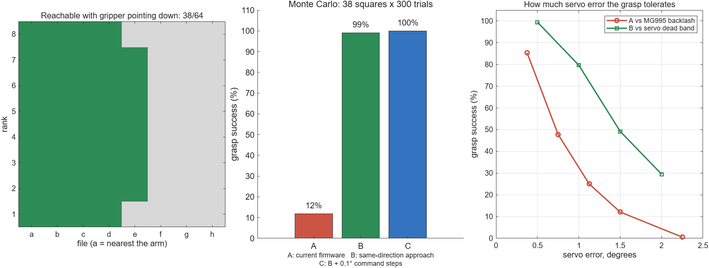

# Low-cost 6-DOF Robotic Arm

A 6-DOF robot arm I built over my summer vacation for under ₹5,000, using 3D-printed parts,
hobby servos (MG995 / MG90S), an ESP32 and my phone as the camera. I never documented it
properly back then, so this repo is me finally putting everything in one place: the CAD,
firmware, MATLAB code, videos, and a simulation I made afterwards to figure out what went wrong.


## The idea

Open-source arms are cool but expensive, mostly because of the motors and electronics. I wanted
to see how cheap I could go and still do something real:

1. the phone camera looks at a chessboard and finds which square an object is on
2. the arm goes there and picks it up
3. it drops it into a small box next to the board

All from one button.

## What I built

- **The arm** - designed in Fusion 360, 3D printed, driven by an ESP32. MATLAB sends joint angles
  over serial and the ESP32 moves the servos.
- **Servo feedback** - cheap servos don't tell you where they are, so I soldered a 4th wire to
  the potentiometer inside each one and read it on the ESP32's analog pins. That's how the arm
  knows its real joint angles.
- **Live mirroring** - the ESP32 sends those angles back every 200 ms, so if I move the arm by hand
  the MATLAB model moves with it. It works the other way too: jog buttons, a target point or a
  square name in the MATLAB app move the real arm.
- **Square by name** - I calibrated the arm square by square on the chessboard (this took a lot of
  hours). Type `e4` and it goes to e4.
- **Camera** - my Android phone running IP Webcam, streamed over Wi-Fi and calibrated in MATLAB
  from 14 photos of the chessboard (0.57 px reprojection error).

## What didn't work

Pick-and-place, which was the whole point. The servos have gear backlash, and across six joints
it adds up. The arm could reach a square, but not accurately enough to actually grab something
and put it down. Calibrating every square got me reaching, not grasping. After many days of
tuning I stopped there.

Honestly I wasn't happy with that. But I'm still proud of the arm itself, and going back to it
later taught me something useful (next section).

## The simulation (what went wrong, and a fix)

In November I simulated the whole task in MATLAB: the arm (from its URDF), the chessboard, the box,
and the phone camera with its real calibration and lens distortion.

```matlab
startup                                   % adds the code to the path (runs automatically in this folder)
pick_and_place_sim("c3", Video="c3.mp4")  % camera finds the cube on c3, arm puts it in the box
```



What it showed:

- the camera finds the right square every time (64/64, median error 0.58 mm)
- the arm can only pick from about half the board (files a-d and most of e) - which is exactly the
  half I had managed to calibrate on the real arm
- every reachable square gets a collision-free pick -> box path
- the real problem is backlash: if a joint can arrive from either side of its gear slack, only
  **12%** of simulated grasps land inside the gripper. If every joint always finishes its move
  from the same side, the slack becomes a fixed offset and that jumps to **99%**

So backlash doesn't have to be removed, just made predictable. I added that to the firmware
(`ANTI_BACKLASH`: downward moves overshoot by 4° and come back up). It still has to be tested on
the real arm.

The simulation also caught a mistake in my URDF: the base rotation axis was 50 mm off the centre
of the base (from the Fusion export). Fixed now.

More detail: [project report](docs/project-report.md) and [simulation notes](docs/simulation-plan.md).

## Videos

All in `docs/media/`:

- `testing_story_hd.mp4` - a test session (`_muted` has no audio)
- `event_demo_elicit25.mp4` - running at the ACM booth at ELICIT'25
- `live_mirroring_1.mp4`, `live_mirroring_2.mp4` - moving the arm by hand, MATLAB model follows
- `arm_moving_bench.mp4`, `arm_moving_closeup.mp4`, `arm_control_from_laptop.mp4` - the arm running
- `assembly_1-3.mp4`, `printing_parts_1-2.mp4` - building it
- `sim_pick_and_place_b3.mp4`, `sim_pick_and_place_c3.mp4` - the simulation
- `linkedin_reel.mp4` - a short highlight cut

## Wiring (ESP32 DevKit V1)

| Servo | GPIO | Joint | Feedback pin |
|---|---|---|---|
| S1 | 13 | base | 33 |
| S2 | 12 | shoulder | 32 |
| S3 | 14 | elbow (mounted inverted) | 35 |
| S4 | 25 | wrist | 36 |
| S5 | 27 | wrist | 34 |
| S6 | 18 | second shoulder servo, mirrors S2 (`180 - S2`) | - |
| Gripper | 26 | SG90-type gripper | - |

Power the servos from a separate supply and connect its ground to the ESP32.
GPIO 12 is a boot pin - if the ESP32 won't boot, unplug S2's signal wire while powering it up.

## Serial commands (115200 baud)

| Send | What it does |
|---|---|
| `s1,s2,s3,s4,s5` | move the five joints (0-180) |
| `s1,s2,s3,s4,s5,g` | same, then set the gripper once the arm gets there |
| `OPEN` / `CLOSE` / `GRIP <angle>` | gripper |
| `HOME` | go to the home pose |
| `CAL` | print the raw feedback readings (for calibrating) |

The ESP32 sends back `f1,...,f6` (measured angles) every 200 ms, plus status lines starting with
`#`. Joints move wrist first, base last, and big moves go through HOME first.

## Running it

1. Flash `firmware/esp32_main` with PlatformIO.
2. Open MATLAB in this folder and run `arm_control_app` (COM port is set at the top, COM9 for me).
3. Pick a square and press **Pick Square -> Box**, or use the jog buttons.
4. No MATLAB? `python vision/robotic_arm_interface.py --port COM9 --angles 90 100 120 80 60`
5. Camera: start IP Webcam on the phone, then
   `python vision/chessboardtracker.py --source http://<phone-ip>:8080/video`

## Folders

```
cad/          Fusion 360 exports (full assembly STEP/STL + each part)
urdf/         URDF, meshes and ROS launch files
matlab/       kinematics, chessboard calibration table, the control app, the simulation
firmware/     esp32_main (current), a servo test, and old versions (stepper base attempt, UNO prototype)
vision/       camera calibration, chessboard tracker, Python serial interface
docs/         project report, simulation notes, photos and videos
tests/        tests that run without the arm (MATLAB, firmware on a PC, camera calibration)
```

## Tests

Everything that can run without the arm passes: 20/20 MATLAB tests, 53/53 firmware checks (run
on a PC with fake Arduino headers), an end-to-end test of the Python interface against a simulated
ESP32, and the camera calibration check. See `tests/`.

## Still to do

- flash the new firmware and set the gripper angles and box position
- re-measure the square table (the anti-backlash moves change where joints settle)
- calibrate the feedback readings with `CAL` (the values in the code are placeholders)
- run the camera detection on the real phone feed instead of picking the square by hand
- switch the app's IK to the URDF model (the old hand-written model doesn't match the arm)

The firmware here is a rebuild - I couldn't find the exact version I used in the summer.

## License

MIT
