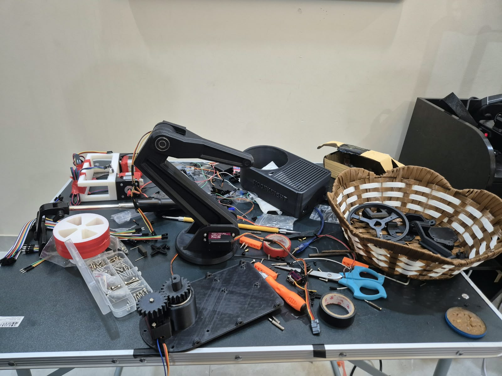

# 6-DOF Robotic Arm (ESP32, MATLAB, URDF)

Six-servo robotic arm. MATLAB models the arm (URDF + `rigidBodyTree`) and solves inverse
kinematics to turn Cartesian targets or chessboard squares into joint angles. The ESP32
receives those angles over serial, drives the servos and sends back the measured angles
from the servos' analog feedback. An Android phone running the IP Webcam app streams
video over Wi-Fi to Python/OpenCV, which is calibrated against the chessboard and maps squares
(a1-h8, 33 mm) into the arm's workspace for vision-guided positioning.

## Why I built it
Open-source robot arms are expensive, mostly because of their motors and electronics. The goal
here was a 6-DOF arm built from 3D-printed parts, hobby servos and an ESP32, as cheap as possible,
that could **pick an object up and place it somewhere else**.

The planned pipeline, started with one button:
1. The phone camera looks at the chessboard and finds which square the object is on.
2. The arm moves to that square and grips the object.
3. It carries it to a small box next to the board and releases it.

## What worked
- Built and tested on the physical arm (summer 2026). After many hours of calibration, the arm
  reached any chessboard square just by typing its name (e.g. `e4`) in the MATLAB app, using a
  per-square servo table measured on the real arm (`matlab/chess/CreateServoInterpolation.m`).
- Live mirroring: moving the real arm by hand moves its MATLAB model, driven by the servos'
  own position feedback (see the videos below).
- Camera calibration with a phone camera (IP Webcam + OpenCV/MATLAB), 0.57 px reprojection error.

## What didn't, and why
- **Pick-and-place was not achieved.** Gear backlash in the hobby servos added up across the
  joints. The arm could reach a square, but not repeatably enough to grip an object and put it
  down accurately. Per-square calibration worked around it for reaching, not for grasping.
- The project ran for many days, and I stopped at this point rather than keep tuning around the
  servos. The main lesson: for a cheap arm, the actuators are the problem to solve first.



**Videos** (`docs/media/`):
- `event_demo_elicit25.mp4` - the arm demoed at the ACM booth at ELICIT'25 (stabilised)
- `testing_story_hd.mp4` - a test session (Instagram story, cropped and enhanced; `_muted` version without the story audio)
- `live_mirroring_1.mp4`, `live_mirroring_2.mp4` - moving the real arm by hand while the MATLAB model follows it from the servo feedback
- `arm_moving_bench.mp4`, `arm_moving_closeup.mp4`, `arm_control_from_laptop.mp4` - the arm running
- `assembly_1-3.mp4` - assembling and handling the arm
- `printing_parts_1-2.mp4` - 3D printing the links
- `linkedin_reel.mp4` - 40 s highlight cut of the above

MATLAB/URDF model: [`docs/media/arm_render.png`](docs/media/arm_render.png).
The 14 chessboard photos used for the MATLAB camera calibration are in `vision/calibration/images/`.

Full project history: [`docs/project-summary.md`](docs/project-summary.md)

## Simulation: the full pick-and-place, with the chessboard and the camera

`matlab/simulation/pick_and_place_sim.m` runs the task the arm was built for, end to end, in
MATLAB: the phone camera (real calibration and lens distortion) sees the board, vision finds which
square the cube is on, IK plans a collision-free path, and the arm carries the cube to the box.

```matlab
addpath(genpath("matlab"))
pick_and_place_sim("b3", Video="pick_b3.mp4")
```


- **Vision:** correct square for 64/64 positions, median error 0.58 mm.
- **Reach:** 38/64 squares can be picked with the gripper pointing down: files a-d and most of e,
  which is exactly the half of the board the real arm was calibrated on.
- **Planning:** all 38 get a collision-free pick -> box -> release plan
  ([video](docs/media/sim_pick_and_place_b3.mp4)).
- **Why the real arm missed:** with typical hobby-servo backlash, only 12 % of grasps land inside
  the 4.5 mm jaw clearance when a joint can arrive from either side (the old firmware). Making
  every joint finish its move from the same side raises that to 99 %. This is now built into
  the firmware (`ANTI_BACKLASH`).

Plan, iterations and limits: [`docs/simulation-plan.md`](docs/simulation-plan.md).
Full write-up: [`docs/project-report.md`](docs/project-report.md).

## Hardware (ESP32 DevKit V1)

| Servo | GPIO | Joint | Feedback GPIO |
|---|---|---|---|
| S1 | 13 | Base | 33 |
| S2 | 12 | Shoulder | 32 |
| S3 | 14 | Elbow (mounted inverted) | 35 |
| S4 | 25 | Wrist | 36 |
| S5 | 27 | Wrist | 34 |
| S6 | 18 | Mirrors S2 (`180 - S2`) | none |
| Gripper | 26 (check your wiring) | SG90-type geared gripper | none |

Power the servos from an external supply and share ground with the ESP32.

**Camera:** Android phone with the [IP Webcam](https://play.google.com/store/apps/details?id=com.pas.webcam) app,
on the same Wi-Fi as the PC. The app shows a stream URL such as `http://192.168.5.122:8080/video`;
the IP changes between networks. Details: [`docs/camera-system.md`](docs/camera-system.md).
GPIO 12 is a boot-strapping pin: if the ESP32 won't boot, unplug S2's signal wire while powering up.

## Folder layout

```
cad/                      Fusion 360 exports: full assembly (.step, .stl) and per-part STLs
urdf/                     ROS package: urdf/robot.urdf, xacro, STL meshes, launch files
matlab/
  setup_paths.m           run first: adds all matlab/ subfolders to the path
  kinematics/             build_robot_model.m (model used for IK), solve_ik_dls.m (IK solver),
                          joints_to_servo.m, robot_model.m (earlier exploratory model)
  chess/                  board <-> robot coordinates, per-square servo table
  hardware/               arm_control_app.m (GUI: IK + send to ESP32),
                          moving_physical_arm.m (live view from ESP32 feedback),
                          esp32_communication.m (serial connection snippet)
  simulation/             pick_and_place_sim.m (one-button simulation) and its sim_*.m parts:
                          scene, camera render, vision, IK, planner, animation, backlash study;
                          collision_check.m (self/ground collision test)
firmware/
  esp32_main/             CURRENT firmware - flash this
  tests/esp32_servo_sweep single-servo sweep on GPIO 18
  archive/                esp32_stepper_j1_attempt (abandoned stepper base),
                          uno_3dof_ik_prototype (early Arduino UNO 3-servo IK version)
vision/                   chessboardtracker.py, cameracalibration.py,
                          generate_robot_squares.py, robotic_arm_interface.py
  calibration/            cameraMatrix.csv, distCoeffs.csv, cameraParams.mat, 14 photos
data/                     robotSquares.mat
docs/                     project-summary.md, camera-system.md, media/ (photos, videos, render)
tests/                    hardware-free tests (see Testing)
```

## Serial protocol (115200 baud, one line per command)

| Direction | Line | Meaning |
|---|---|---|
| PC -> ESP32 | `s1,s2,s3,s4,s5` | Five joint angles 0-180 in MATLAB's frame (what `arm_control_app.m` sends) |
| PC -> ESP32 | `s1,s2,s3,s4,s5,g` | Same, then set the gripper to `g` once the arm has arrived |
| PC -> ESP32 | `OPEN` / `CLOSE` | Open / close the gripper (`GRIP OPEN`, `GRIP CLOSE` also work) |
| PC -> ESP32 | `GRIP <0-180>` | Set the gripper to an angle (use it to find the open/closed values) |
| PC -> ESP32 | `HOME` | Move to the home pose |
| PC -> ESP32 | `CAL` | Print raw ADC values of FB1-FB5 |
| ESP32 -> PC | `f1,f2,f3,f4,f5,f6` | Measured angles in the same frame, every 200 ms and after each move (f6 = commanded S6) |
| ESP32 -> PC | `# GRIP <angle>` | Gripper position after every gripper command |
| ESP32 -> PC | `# ...` | Status / errors |

Every joint finishes its move travelling upward (`ANTI_BACKLASH`, 4 deg overshoot on downward
moves), so gear backlash always sits on the same side. The firmware moves the joints wrist to base (S5, S4, S3, S2 with S6, then S1). If any joint
has to move more than 30 deg, it goes to HOME first (A1 -> HOME -> B1). Small moves, such as
the jog buttons, go straight to the target.

## Running
1. Flash `firmware/esp32_main` with PlatformIO (it pulls in `ESP32Servo`).
2. MATLAB: `run matlab/setup_paths.m`, then `arm_control_app` (the COM port is set at the top of the file, currently COM9).
3. Pick and place: pick a square in the app and press **Pick Square -> Box**
   (`matlab/hardware/pick_and_place.m`: open, go to the square, close, lift, go to the box, open, home).
   Set `boxPose` at the top of `arm_control_app.m` to the servo angles above your box first.
4. Python instead of MATLAB: `python vision/robotic_arm_interface.py --port COM9 --angles 90 100 120 80 60` (needs `pyserial`).
5. Vision: start IP Webcam on the phone, then
   `python vision/chessboardtracker.py --source http://<phone-ip>:8080/video --rotate 0`
   (`--source 0` uses a USB webcam, or pass a photo to try it without a camera).

## Testing (no hardware needed)

| What | How to run | Last result |
|---|---|---|
| MATLAB: URDF + meshes, IK, chess squares, servo table, scripts run headless | `run_tests` in `tests/matlab` (several minutes) | 15/15 pass (IK on random reachable poses: 11/12 within 1 mm) |
| Pick-and-place sequence and the app's buttons, against a fake ESP32 | part of the MATLAB tests | pass |
| Pick-and-place simulation: vision, reach, collision-free plan, backlash strategies | part of the MATLAB tests | pass |
| IK reaches every chess square | part of the MATLAB tests | 64/64 at board level (worst 0.10 mm) and 30 mm above (worst 0.72 mm) |
| Firmware logic on a PC (order, S3 inversion, S6 mirror, HOME-first, clamping, bad packets, feedback) | `cd tests/firmware_sim && g++ -std=gnu++17 -Istub test_firmware.cpp -o test_firmware && ./test_firmware` | 47/47 checks (incl. gripper) |
| Every packet MATLAB sends is accepted by the firmware | `export_packets` in MATLAB, then the firmware test above | 128/128 |
| Python interface <-> simulated ESP32 over a virtual serial port, incl. a full pick-and-place (Linux/WSL) | `g++ -std=gnu++17 -Istub sim_main.cpp -o sim_firmware && python3 test_end_to_end.py ./sim_firmware` | pass |
| Camera calibration against the 14 photos | `python tests/vision/test_calibration.py` | 0.57 px mean reprojection error (9/14 boards detected) |

Not covered without hardware: real servo motion and timing, real ADC feedback, and the
interactive parts of `chessboardtracker.py` and `arm_control_app.m` (mouse clicks / GUI).

## Calibrating the feedback (do this first)
`adcAt0` / `adcAt180` in `firmware/esp32_main/src/main.cpp` are still the placeholder values
from the old code. For each servo: move it to 0 deg, send `CAL`, note its FB value; repeat at
180 deg; then put both numbers into the arrays and re-flash.

## Still open
- **Re-measure the square table with the new firmware.** The anti-backlash approach shifts where
  each joint settles, so the old hand-measured angles will be off by roughly the backlash.
- Gripper: the pin (GPIO 26), `GRIPPER_OPEN`/`GRIPPER_CLOSED` in the firmware and `boxPose`
  in the app are placeholders - check the wiring and measure them with `GRIP <angle>` and the jog buttons.
- Camera -> square -> pick is connected in the simulation (`pick_and_place_sim.m`), but not yet
  on the real arm: the app still uses a square picked by hand. Porting it means running
  `sim_detect_object.m` on the live phone image (with a green sticker on the board frame).
- The URDF gripper is one rigid part, so the simulation doesn't show the fingers opening.
- Feedback calibration values (above) and the HOME pose (all 90 deg) are unverified.
- S6 has no feedback channel.
- `matlab/chess/CreateServoInterpolation.m`: square a8 isn't measured, and only files a-d
  are measured. Files e-h are extrapolated (11 values fall outside 0-180 and are clamped).
  The simulation shows f-h are out of reach with the gripper pointing down anyway, so the
  usable workspace is files a-d (and most of e).
- Square-by-name moves use the hand-calibrated servo table, which is what worked on the
  real arm. The Cartesian IK model gives different angles for the same squares (square a1:
  IK `116,120,121,94,90`, table `31,88,25,110,150`), so its board placement / servo zero
  offsets still need matching to the real arm before X/Y/Z targets are used on hardware.
- `firmware/esp32_main` was rebuilt from the project notes (the exact firmware used in the
  summer tests wasn't recovered) and has only been tested in simulation.
- `build_robot_model.m` (the app's IK model) is mirrored along X relative to the URDF and its
  wrist link is ~15 mm shorter. The URDF is the better model (it is used by the simulation and
  had its base axis corrected), so the app's IK should eventually move to the URDF too.
- Arrival is assumed after a fixed delay, not confirmed from feedback (no closed loop yet).

## License
MIT - see [LICENSE](LICENSE).
