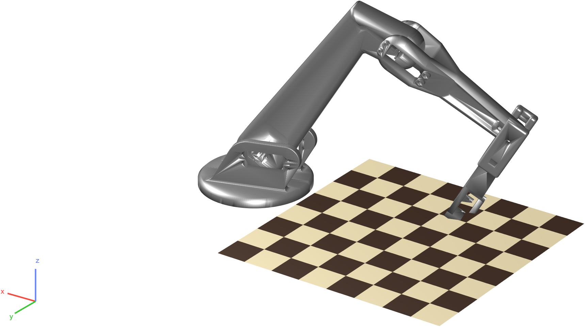

# 6-DOF Robotic Arm (ESP32, MATLAB, URDF)

Six-servo robotic arm. MATLAB models the arm (URDF + `rigidBodyTree`) and solves inverse
kinematics to turn Cartesian targets or chessboard squares into joint angles. The ESP32
receives those angles over serial, drives the servos and sends back the measured angles
from the servos' analog feedback. An Android phone running the IP Webcam app streams
video over Wi-Fi to Python/OpenCV, which is calibrated against the chessboard and maps squares
(a1-h8, 33 mm) into the arm's workspace for vision-guided positioning.

**Status:** built and tested on the physical arm (summer 2026). After many hours of
calibration, the arm reached any chessboard square just by typing its name (e.g. `e4`) in the
MATLAB app, using the per-square servo table measured on the real arm
(`matlab/chess/CreateServoInterpolation.m`).



Full project history: [`docs/project-summary.md`](docs/project-summary.md)

## Hardware (ESP32 DevKit V1)

| Servo | GPIO | Joint | Feedback GPIO |
|---|---|---|---|
| S1 | 13 | Base | 33 |
| S2 | 12 | Shoulder | 32 |
| S3 | 14 | Elbow (mounted inverted) | 35 |
| S4 | 25 | Wrist | 36 |
| S5 | 27 | Wrist | 34 |
| S6 | 18 | Mirrors S2 (`180 - S2`) | none |

Power the servos from an external supply and share ground with the ESP32.

**Camera:** Android phone with the [IP Webcam](https://play.google.com/store/apps/details?id=com.pas.webcam) app,
on the same Wi-Fi as the PC. The app shows a stream URL such as `http://192.168.5.122:8080/video`;
the IP changes between networks. Details: [`docs/camera-system.md`](docs/camera-system.md).
GPIO 12 is a boot-strapping pin: if the ESP32 won't boot, unplug S2's signal wire while powering up.

## Folder layout

```
cad/                      Fusion 360 exports: full assembly (.step, .stl) and per-part STLs
urdf/                     ROS package: urdf/robot.urdf, xacro, STL meshes, launch files
matlab/
  setup_paths.m           run first: adds all matlab/ subfolders to the path
  kinematics/             build_robot_model.m (model used for IK), solve_ik_dls.m (IK solver),
                          joints_to_servo.m, robot_model.m (earlier exploratory model)
  chess/                  board <-> robot coordinates, per-square servo table
  hardware/               arm_control_app.m (GUI: IK + send to ESP32),
                          moving_physical_arm.m (live view from ESP32 feedback),
                          esp32_communication.m (serial connection snippet)
  simulation/             collision_check.m (self/ground collision test)
firmware/
  esp32_main/             CURRENT firmware - flash this
  tests/esp32_servo_sweep single-servo sweep on GPIO 18
  archive/                esp32_stepper_j1_attempt (abandoned stepper base),
                          uno_3dof_ik_prototype (early Arduino UNO 3-servo IK version)
vision/                   chessboardtracker.py, cameracalibration.py,
                          generate_robot_squares.py, robotic_arm_interface.py
  calibration/            cameraMatrix.csv, distCoeffs.csv, cameraParams.mat, 14 photos
data/                     robotSquares.mat
docs/                     project-summary.md, camera-system.md, media/arm_render.png
tests/                    hardware-free tests (see Testing)
```

## Serial protocol (115200 baud, one line per command)

| Direction | Line | Meaning |
|---|---|---|
| PC -> ESP32 | `s1,s2,s3,s4,s5` | Five joint angles 0-180 in MATLAB's frame (what `arm_control_app.m` sends) |
| PC -> ESP32 | `HOME` | Move to the home pose |
| PC -> ESP32 | `CAL` | Print raw ADC values of FB1-FB5 |
| ESP32 -> PC | `f1,f2,f3,f4,f5,f6` | Measured angles in the same frame, every 200 ms and after each move (f6 = commanded S6) |
| ESP32 -> PC | `# ...` | Status / errors |

The firmware moves the joints wrist to base (S5, S4, S3, S2 with S6, then S1). If any joint
has to move more than 30 deg, it goes to HOME first (A1 -> HOME -> B1). Small moves, such as
the jog buttons, go straight to the target.

## Running
1. Flash `firmware/esp32_main` with PlatformIO (it pulls in `ESP32Servo`).
2. MATLAB: `run matlab/setup_paths.m`, then `arm_control_app` (the COM port is set at the top of the file, currently COM9).
3. Python instead of MATLAB: `python vision/robotic_arm_interface.py --port COM9 --angles 90 100 120 80 60` (needs `pyserial`).
4. Vision: start IP Webcam on the phone, then
   `python vision/chessboardtracker.py --source http://<phone-ip>:8080/video --rotate 0`
   (`--source 0` uses a USB webcam, or pass a photo to try it without a camera).

## Testing (no hardware needed)

| What | How to run | Last result |
|---|---|---|
| MATLAB: URDF + meshes, IK, chess squares, servo table, scripts run headless | `run_tests` in `tests/matlab` (several minutes) | 12/12 pass (IK on random reachable poses: 11/12 within 1 mm) |
| IK reaches every chess square | part of the MATLAB tests | 64/64 at board level (worst 0.10 mm) and 30 mm above (worst 0.72 mm) |
| Firmware logic on a PC (order, S3 inversion, S6 mirror, HOME-first, clamping, bad packets, feedback) | `cd tests/firmware_sim && g++ -std=gnu++17 -Istub test_firmware.cpp -o test_firmware && ./test_firmware` | 37/37 checks |
| Every packet MATLAB sends is accepted by the firmware | `export_packets` in MATLAB, then the firmware test above | 128/128 |
| Python interface <-> simulated ESP32 over a virtual serial port (Linux/WSL) | `g++ -std=gnu++17 -Istub sim_main.cpp -o sim_firmware && python3 test_end_to_end.py ./sim_firmware` | pass |
| Camera calibration against the 14 photos | `python tests/vision/test_calibration.py` | 0.57 px mean reprojection error (9/14 boards detected) |

Not covered without hardware: real servo motion and timing, real ADC feedback, and the
interactive parts of `chessboardtracker.py` and `arm_control_app.m` (mouse clicks / GUI).

## Calibrating the feedback (do this first)
`adcAt0` / `adcAt180` in `firmware/esp32_main/src/main.cpp` are still the placeholder values
from the old code. For each servo: move it to 0 deg, send `CAL`, note its FB value; repeat at
180 deg; then put both numbers into the arrays and re-flash.

## Still open
- Feedback calibration values (above) and the HOME pose (all 90 deg) are unverified.
- S6 has no feedback channel.
- `matlab/chess/CreateServoInterpolation.m`: square a8 isn't measured, and only files a-d
  are measured. Files e-h are extrapolated; 11 of those values fall outside 0-180 and are
  clamped by the app, so measure e-h before using them.
- Square-by-name moves use the hand-calibrated servo table, which is what worked on the
  real arm. The Cartesian IK model gives different angles for the same squares (square a1:
  IK `116,120,121,94,90`, table `31,88,25,110,150`), so its board placement / servo zero
  offsets still need matching to the real arm before X/Y/Z targets are used on hardware.
- `firmware/esp32_main` was rebuilt from the project notes (the exact firmware used in the
  summer tests wasn't recovered) and has only been tested in simulation.
- `build_robot_model.m` is mirrored along X relative to the URDF and its wrist link is
  ~15 mm shorter, so the live view in `moving_physical_arm.m` (URDF) may not match the IK model.
- Arrival is assumed after a fixed delay, not confirmed from feedback (no closed loop yet).
