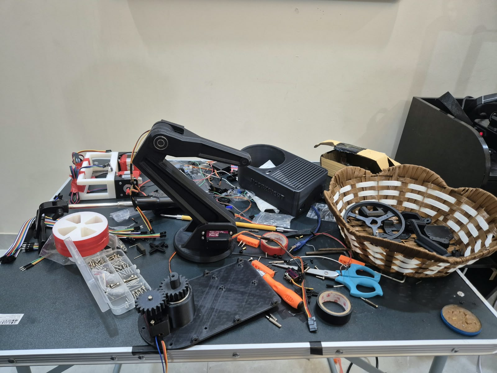
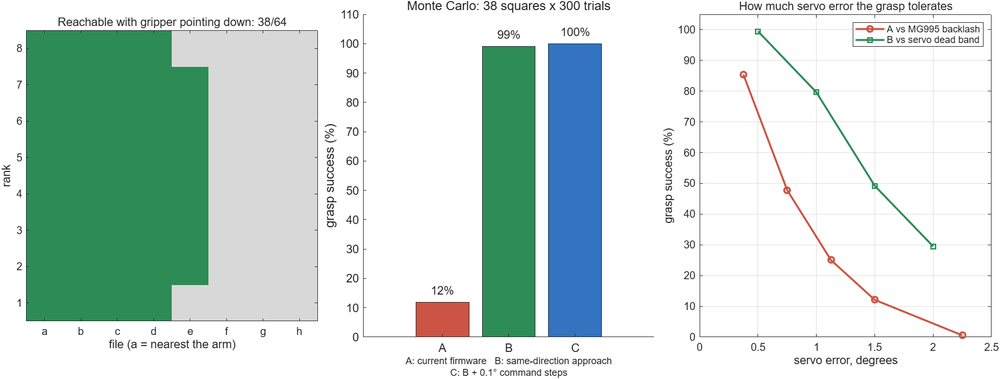

# 6-DOF Robotic Arm - Project Report

Naman Saluja · November 2026

## Summary

I built a low-cost 6-DOF robotic arm from 3D-printed parts, hobby servos and an ESP32, aiming for camera-guided pick-and-place on a chessboard. On the physical arm, typing a square such as `e4` sent the arm to that square after many hours of per-square calibration, and the arm was demoed at the ACM booth at ELICIT'25. Pick-and-place did not work: gear backlash in the servos made the grasp too inaccurate.

A MATLAB simulation of the full task, with the chessboard, the phone camera and the box, explains why. With typical hobby-servo backlash, only 12 % of simulated grasps land within the gripper's 4.5 mm clearance. When every joint finishes its move from the same side, 99 % do. That fix is now in the firmware, and the code, models and tests are cleaned up for publishing.

## Goal

Open-source robot arms are expensive, mostly because of their motors and electronics. The goal was the cheapest arm that could still do a real task: pick up an object and drop it in a box, started with one button.

1. A phone camera looks at a chessboard and finds which square the object is on.
2. The arm moves to that square and grips the object.
3. It carries the object to a small box next to the board and releases it.

The build ran over the 2026 summer vacation: design in Fusion 360, 3D printing, wiring, firmware, MATLAB modelling and camera calibration.



## System design

The PC does the thinking (vision, kinematics, the chess-square table) and sends five joint angles per move to the ESP32 over USB serial. The ESP32 drives the servos and reports the measured angles back.

```
Phone camera --Wi-Fi--> PC: vision -> square table or IK --USB serial--> ESP32 --PWM--> arm (6 servos + gripper)
                          ^                                                 |
                          +---------- measured angles, every 200 ms --------+
```

| Part | What it is | Notes |
| --- | --- | --- |
| Mechanics | Fusion 360 design, 3D-printed links, 8x8 chessboard with 33 mm squares | STEP, STL and URDF exported from the same model |
| Joints | 5 arm joints: base, shoulder (two servos, S6 mirrors S2), elbow, two wrist joints | MG995 servos on the large joints, MG90S on the wrist |
| Gripper | Geared SG90-type gripper on its own servo | Jaws open about 29 mm |
| Controller | ESP32 DevKit V1, external servo supply, common ground | Servo pins 13, 12, 14, 25, 27, 18; gripper 26 |
| Feedback | Servo potentiometers read on ADC pins 33, 32, 35, 36, 34 | Five channels; S6 has none |
| PC software | MATLAB app (IK, chess squares, jog buttons), Python serial interface | The app sends `s1,s2,s3,s4,s5` lines at 115200 baud |
| Camera | Android phone running IP Webcam, streamed over Wi-Fi to OpenCV and MATLAB | Calibrated on 14 chessboard photos, 0.57 px error |
| Model | URDF with STL meshes, MATLAB `rigidBodyTree` | Used for IK, collision checks and the simulation |

The serial protocol is one line per command. The PC sends `s1,s2,s3,s4,s5` for a move (an optional sixth value sets the gripper), plus `HOME`, `OPEN`, `CLOSE`, `GRIP <angle>` and `CAL`. The ESP32 answers with `f1,...,f6` feedback lines every 200 ms and `#` status lines such as `# OK` and `# GRIP 110`.

## Results on the physical arm

The arm reached chessboard squares by name and mirrored its own motion in MATLAB, but it could not pick and place.

**What worked**

- Square by name: typing a square in the MATLAB app moved the arm to it. Each square's five servo angles were measured by hand on files a-d and interpolated between them. This took many hours of calibration.
- Live mirroring: moving the arm by hand moved its MATLAB model, driven by the servos' own position feedback ([video 1](media/live_mirroring_1.mp4), [video 2](media/live_mirroring_2.mp4)).
- Camera: the phone camera was calibrated against the chessboard in MATLAB, with 0.57 px mean reprojection error on the 9 photos where the board is detected.
- Demo: the arm ran at the ACM booth at ELICIT'25 ([video](media/event_demo_elicit25.mp4)).

**What did not**

- Pick-and-place: the arm reached each square, but not repeatably enough to grip a cube and set it down. Gear backlash in the servos adds up across the joints.
- Vision never drove the arm: the camera and the chessboard tracker existed, but the square was always chosen by hand.
- A stepper motor for the base was tried and dropped; the arm stayed all-servo.
- The project ran for many days, and I stopped at this point rather than keep tuning around the servos.

The original summer firmware was not recovered. The firmware in the repository was rebuilt from the project notes and has only been tested in simulation.

## Simulation of the full task

The simulation runs the intended one-button task end to end in MATLAB and reproduces what happened on the real arm. `pick_and_place_sim("b3")` renders the phone camera's view with the real calibration and lens distortion, finds the board and the cube, solves IK with the gripper pointing down, plans a quintic joint trajectory (above cube, grasp, lift, above box, release, home), and checks every sample for collisions with the board, the box walls and the carried cube. Video: [sim_pick_and_place_b3.mp4](media/sim_pick_and_place_b3.mp4).

| Check | Result |
| --- | --- |
| Camera finds the right square | 64/64 squares, median error 0.58 mm, worst 1.12 mm |
| Squares the arm can pick (gripper down, 60 mm approach) | 38/64: files a-d and most of e, the same half the real arm was calibrated on |
| Full pick, box, release plans with no collision | 38/38 reachable squares |
| Grasp success, current firmware | 12 %, median miss 9.0 mm |
| Grasp success, same-direction approach | 99 %, median miss 1.9 mm |
| Grasp success, same-direction + 0.1 degree commands | 100 %, median miss 1.4 mm |

The grasp numbers come from a Monte Carlo study: 38 squares x 300 trials. The servo errors are assumed typical values, not measurements of this arm: +/-1.5 degree backlash on the MG995 joints, +/-2.5 degree on the micro-servo wrist, a +/-0.5 degree dead band, and whole-degree commands. A grasp succeeds when the fingertip lands within the 4.5 mm side clearance between the open jaws and the 20 mm cube, without hitting the board.



With the old firmware, even 0.75 degree of backlash halves the success rate. Approaching from one side keeps it at 99 % as long as each servo stops within about 0.5 degree of its target.

**How the plan changed while running it**

| Version | Problem found | Change |
| --- | --- | --- |
| v2 | A dark bow-tie across the camera image: the lens-distortion model folds points far outside the view back into it | Clip every polygon to the field of view before projecting; draw flat layers in order |
| v3 | 50/64 squares found; file and rank swapped | A square board looks the same rotated or mirrored: a green sticker off the board's diagonal, on the edge nearest the camera. Now 64/64 |
| v4 | The arm collided with the board at the home pose | The board sat inside the 60 mm base disc, and the URDF's base axis was 50 mm off the disc centre (a Fusion export error). Fixed both |
| v5 | Only the near ranks were reachable, unlike the real table | The real board runs files a-h away from the arm (as in `CreateChessBoard.m`); turned it. Reach now matches the calibrated half |
| v6 | Full task | Camera, IK, trajectory, collision check and animation in one call; 38/38 plans collision-free |
| v7 | Why the real arm missed | Backlash study (table above); same-direction approach built into the firmware |

The simulation has limits: the gripper is one rigid part with no contact physics, the camera image is flat-shaded, and the servo errors are assumed. Full plan: [simulation-plan.md](simulation-plan.md).

## Improvements made after the build

The biggest change is the anti-backlash approach in the firmware; the rest makes the project complete and reproducible.

| Change | Why | Where |
| --- | --- | --- |
| Every joint finishes its move travelling upward (4 degree overshoot on downward moves) | Backlash becomes a constant offset that calibration absorbs: 12 % to 99 % simulated grasps | `firmware/esp32_main` (`ANTI_BACKLASH`) |
| Gripper control: `OPEN`, `CLOSE`, `GRIP <angle>`, optional sixth packet value | No code opened or closed the gripper, so pick-and-place was blocked in software too | Firmware, MATLAB app, Python interface |
| One-button pick-and-place: Pick Square -> Box | The sequence open, pick, close, lift, place, open, home, each step confirmed by the ESP32 | `matlab/hardware/pick_and_place.m` |
| Base rotation axis moved to the base disc centre | The Fusion export put it 50 mm off, so the model swung the arm round the wrong point | `urdf/urdf/robot.urdf` |
| URDF package renamed, launch files fixed, xacro synced | The package was `Untitled_description`, launch files pointed at a missing file, and the xacro had no base joint | `urdf/` |
| Servo 6 driven as 180 - S2 | Calculated before but never sent | Firmware |
| IK solver step size 0.1 to 1.0 | About 125 iterations (~5 s) per solve became about 11 (~0.5 s), same accuracy | `matlab/kinematics/solve_ik_dls.m` |
| Bugs: a crash in `CreateServoInterpolation.m`, a syntax error in `moving_physical_arm.m`, `robot_model.m` crash, a function that closed all figures | Each stopped a script from running | `matlab/` |
| Camera tracker takes `--source` (phone URL, webcam or photo) | The phone's IP was hard-coded | `vision/chessboardtracker.py` |
| Folder structure, README, MIT license, git repository | The project was spread over five folders with no documentation | Whole repository |

The square table was measured with the old firmware. With the anti-backlash approach each joint settles on the other side of its backlash, so the table should be re-measured before relying on it.

## Testing

Everything that can run without the arm passes; real servo motion, real feedback and the click-driven GUIs still need the hardware.

| Suite | Covers | Result |
| --- | --- | --- |
| MATLAB unit tests (`tests/matlab`) | URDF and meshes, IK on random poses and all 64 squares, servo table, chess geometry, scripts run headless, pick-and-place against a fake ESP32, app builds, simulation vision, reach, planning and backlash | 20/20 pass |
| Firmware on a PC (`tests/firmware_sim`) | Move order, S3 inversion, S6 mirror, HOME first on large moves, clamping, bad packets, feedback maths, gripper, anti-backlash, every packet MATLAB generates | 53/53 checks; 128/128 packets accepted |
| End to end (`test_end_to_end.py`) | Python interface to the simulated ESP32 over a virtual serial port, including a full pick-and-place | Pass |
| Camera calibration (`test_calibration.py`) | Saved calibration re-projected on the 14 photos | 0.57 px mean, 0.82 px worst |
| MATLAB Code Analyzer | All 29 `.m` files | No messages |

The firmware was compiled on a PC against stand-in Arduino headers, because PlatformIO could not be installed in the test environment. A real ESP32 build is still to be done.

## Limitations and next steps

The next step is one real pick-and-place on the arm with the new firmware; the simulation says it should work on files a-d.

- [ ] Flash `firmware/esp32_main` and check the gripper pin (GPIO 26) against the wiring.
- [ ] Measure the gripper's open and closed angles with `GRIP <angle>`, and the box pose with the jog buttons.
- [ ] Re-measure the square table with the anti-backlash firmware (files a-d; a8 was never measured).
- [ ] Calibrate the five feedback channels with `CAL` at 0 and 180 degrees; the values in the code are placeholders.
- [ ] Run the vision step on the live phone image (`sim_detect_object.m`, with a green sticker on the board frame) so the camera picks the square.
- [ ] Move the app's IK to the URDF model: `build_robot_model.m` is mirrored and about 15 mm short at the wrist, and disagrees with the measured table.
- [ ] Confirm arrival from feedback instead of a fixed delay (closed loop).

**Lessons**

- On a cheap arm, the actuators decide what is possible. Calibration can hide backlash for reaching a point, not for grasping.
- Backlash does not have to be removed, only made predictable: approach every target from the same side.
- Simulate the whole task early. The simulation found a 50 mm error in the URDF and showed which half of the board the arm can reach, before any calibration time was spent.
- Keep one model of the arm. The app's hand-written model and the URDF drifted apart, and the IK never matched the real arm.
